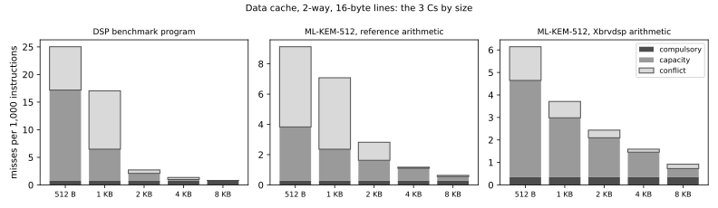
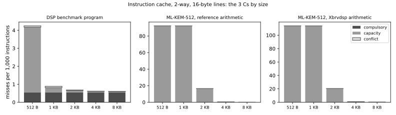

# Cache sweeps: size, associativity, line size, and the 3 Cs

Both caches are write-through, 2-way, 16-byte lines, 2 KB each (64 sets). This
document varies them and splits every miss into the three Cs (H&P 6th ed. App. B, §B.3;
also §2.2 and §2.3 for the design space): compulsory (the first touch of a line),
capacity (a miss that a fully associative LRU cache of the same size would also take)
and conflict (the rest). Workloads are the benchmark set of [cpi_breakdown.md](cpi_breakdown.md):
the whole DSP benchmark program, and the whole of ML-KEM-512 with the reference and the
Xbrvdsp arithmetic. [cpi_breakdown.md](cpi_breakdown.md) found memory the largest cost of
ML-KEM (D-cache 0.30 to 0.41, I-cache 0.18 to 0.26 stall cycles per instruction).

## What the RTL can run, and what the model adds

* **Size** is the RTL's `SETS` parameter, now a macro default in `rtl/pkg/brv32p_cache.vh`
  (`-DIC_SETS_DEFAULT`, `-DDC_SETS_DEFAULT`; the SoC passes them on): 16 to 256 sets of 2
  ways x 16 bytes = 512 B to 8 KB. Each size was simulated, each cache alone with the other at
  2 KB: 9 builds, 3 programs each.
* **Ways and line size cannot be changed in this RTL, and I did not change the cache logic.**
  The `WAYS` parameter exists but the hit logic, the replacement bit (one per set) and the
  fill (a 2-bit word counter that stops at 3) are written for exactly 2 ways and 4-word lines.
  So 1 way, 4 ways and 32-byte lines are measured **in the model only** (`tests/bench/cache_model.py`),
  which replays the access stream the testbench logs (`+cachelog=`).
* **The model is checked against the RTL.** The model is true LRU, write-allocate (the D-cache fetches
  the line on a write miss), no prefetch. For every size the RTL ran (4 sizes x 2 caches x 3
  programs, plus the default) its miss count equals the RTL's exactly; the two columns "CPI (RTL)"
  and "CPI (model)" below differ only in how the cycles were obtained. A short run of this check is in CI
  (`tests/bench/cache_sweep.sh smoke`).
* **Miss penalty** is measured, not assumed: the testbench records when each fill starts and ends
  and the table uses the mean: 14.1 to 14.6 cycles per instruction-side miss and 13.0 per
  data-side miss (a clean I-cache miss is 13 cycles, as in
  [cpi_breakdown.md](cpi_breakdown.md)). One-cycle hits: AMAT = 1 + miss rate x penalty.
  The data-side figure includes the waits for the write buffer that a fill sometimes needs.
* **CPI** is cycles / instructions, from the RTL run where there is one. In the model columns it is estimated:
  the default's CPI plus the change in misses x penalty per instruction, the other cache at its default. The two agree to 0.003 in the data
  cache; for the instruction cache of ML-KEM at 512 B and 1 KB the estimate is too low by 0.13 to 0.16: there the
  cache thrashes on almost every line and the misses queue behind each other and behind the data side, so one penalty
  per miss undercounts.
* **Miss rate** = misses / accesses, where an access is a fetch delivered to the pipeline (so a fetch
  squashed by a mispredict counts, as it does in the cache) or a load or store leaving MEM; peripheral accesses are
  not cached and are left out. "Per 1,000 instr" divides by retired instructions.

Tools: Verilator 5.020 (`tests/bench/sim.sh`; Icarus 12 gives the same cycles), `tests/bench/cache_sweep.sh`, `cache_model.py`,
`cache_report.py`. The sweep takes about 35 minutes under Verilator; the model replays one to four million logged accesses
per program against all 30 cache shapes.

## Plots





## Tables

#### DSP benchmark program: instruction cache, 2 ways, 16-byte lines

2,099,017 instructions, 2,130,058 accesses, mean miss penalty 14.1 cycles (measured).

| size | misses | miss rate | per 1,000 instr | compulsory | capacity | conflict | AMAT (cycles) | CPI (RTL) | CPI (model) |
|---|--:|--:|--:|--:|--:|--:|--:|--:|--:|
| 512 B | 8,914 | 0.418% | 4.25 | 1,151 | 7,612 | 151 | 1.0592 | 1.2650 | 1.2681 |
| 1 KB | 1,866 | 0.088% | 0.89 | 1,151 | 553 | 162 | 1.0124 | 1.2205 | 1.2206 |
| 2 KB | 1,429 | 0.067% | 0.68 | 1,151 | 227 | 51 | 1.0095 | 1.2177 | 1.2177 |
| 4 KB | 1,297 | 0.061% | 0.62 | 1,151 | 120 | 26 | 1.0086 | 1.2168 | 1.2168 |
| 8 KB | 1,272 | 0.060% | 0.61 | 1,151 | 85 | 36 | 1.0084 | 1.2166 | 1.2166 |

Associativity and line size (I-cache; model only; CPI estimated from misses x penalty, the line-32 penalty is not measured so CPI is left out):

| size | 1-way | 2-way | 4-way | 2-way, 32-byte lines |
|---|--:|--:|--:|--:|
| 512 B | 3.71 (7% conf.) | 4.25 (2% conf.) | 4.26 (1% conf.) | 2.26 (4% conf.) |
| 1 KB | 0.93 (16% conf.) | 0.89 (9% conf.) | 0.85 (4% conf.) | 0.48 (11% conf.) |
| 2 KB | 0.74 (12% conf.) | 0.68 (4% conf.) | 0.67 (2% conf.) | 0.35 (5% conf.) |
| 4 KB | 0.69 (12% conf.) | 0.62 (2% conf.) | 0.62 (2% conf.) | 0.31 (2% conf.) |
| 8 KB | 0.62 (8% conf.) | 0.61 (3% conf.) | 0.60 (0% conf.) | 0.31 (3% conf.) |

Misses per 1,000 instructions, with the conflict share of them.


#### DSP benchmark program: data cache, 2 ways, 16-byte lines

2,099,017 instructions, 506,439 accesses, mean miss penalty 13.0 cycles (measured).

| size | misses | miss rate | per 1,000 instr | compulsory | capacity | conflict | AMAT (cycles) | CPI (RTL) | CPI (model) |
|---|--:|--:|--:|--:|--:|--:|--:|--:|--:|
| 512 B | 52,534 | 10.373% | 25.03 | 1,572 | 34,498 | 16,464 | 2.3486 | 1.5104 | 1.5077 |
| 1 KB | 35,778 | 7.065% | 17.05 | 1,572 | 12,031 | 22,175 | 1.9185 | 1.4064 | 1.4039 |
| 2 KB | 5,709 | 1.127% | 2.72 | 1,572 | 2,823 | 1,314 | 1.1466 | 1.2177 | 1.2177 |
| 4 KB | 2,843 | 0.561% | 1.35 | 1,572 | 505 | 766 | 1.0730 | 1.1999 | 1.1999 |
| 8 KB | 1,726 | 0.341% | 0.82 | 1,572 | 150 | 4 | 1.0443 | 1.1929 | 1.1930 |

Associativity and line size (D-cache; model only; CPI estimated from misses x penalty, the line-32 penalty is not measured so CPI is left out):

| size | 1-way | 2-way | 4-way | 2-way, 32-byte lines |
|---|--:|--:|--:|--:|
| 512 B | 58.06 (64% conf.) | 25.03 (31% conf.) | 23.42 (16% conf.) | 22.86 (42% conf.) |
| 1 KB | 18.32 (68% conf.) | 17.05 (62% conf.) | 7.95 (13% conf.) | 14.53 (72% conf.) |
| 2 KB | 11.32 (83% conf.) | 2.72 (23% conf.) | 2.27 (5% conf.) | 1.59 (32% conf.) |
| 4 KB | 8.06 (88% conf.) | 1.35 (27% conf.) | 0.93 (4% conf.) | 0.70 (28% conf.) |
| 8 KB | 2.30 (66% conf.) | 0.82 (0% conf.) | 0.84 (0% conf.) | 0.41 (0% conf.) |

Misses per 1,000 instructions, with the conflict share of them.


#### ML-KEM-512, reference arithmetic: instruction cache, 2 ways, 16-byte lines

4,188,785 instructions, 4,260,266 accesses, mean miss penalty 14.6 cycles (measured).

| size | misses | miss rate | per 1,000 instr | compulsory | capacity | conflict | AMAT (cycles) | CPI (RTL) | CPI (model) |
|---|--:|--:|--:|--:|--:|--:|--:|--:|--:|
| 512 B | 386,690 | 9.077% | 92.32 | 549 | 386,112 | 29 | 2.3246 | 2.9032 | 2.7699 |
| 1 KB | 386,568 | 9.074% | 92.29 | 549 | 385,989 | 30 | 2.3242 | 2.9028 | 2.7694 |
| 2 KB | 69,578 | 1.633% | 16.61 | 549 | 69,013 | 16 | 1.2383 | 1.6651 | 1.6651 |
| 4 KB | 1,825 | 0.043% | 0.44 | 549 | 738 | 538 | 1.0063 | 1.4300 | 1.4290 |
| 8 KB | 554 | 0.013% | 0.13 | 549 | 3 | 2 | 1.0019 | 1.4254 | 1.4246 |

Associativity and line size (I-cache; model only; CPI estimated from misses x penalty, the line-32 penalty is not measured so CPI is left out):

| size | 1-way | 2-way | 4-way | 2-way, 32-byte lines |
|---|--:|--:|--:|--:|
| 512 B | 92.34 (0% conf.) | 92.32 (0% conf.) | 92.32 (0% conf.) | 46.57 (0% conf.) |
| 1 KB | 92.31 (0% conf.) | 92.29 (0% conf.) | 92.28 (0% conf.) | 46.54 (0% conf.) |
| 2 KB | 11.37 (0% conf.) | 16.61 (0% conf.) | 26.43 (0% conf.) | 9.42 (0% conf.) |
| 4 KB | 0.41 (30% conf.) | 0.44 (29% conf.) | 0.42 (20% conf.) | 0.23 (29% conf.) |
| 8 KB | 0.13 (2% conf.) | 0.13 (0% conf.) | 0.13 (0% conf.) | 0.07 (1% conf.) |

Misses per 1,000 instructions, with the conflict share of them.


#### ML-KEM-512, reference arithmetic: data cache, 2 ways, 16-byte lines

4,188,785 instructions, 1,592,231 accesses, mean miss penalty 13.0 cycles (measured).

| size | misses | miss rate | per 1,000 instr | compulsory | capacity | conflict | AMAT (cycles) | CPI (RTL) | CPI (model) |
|---|--:|--:|--:|--:|--:|--:|--:|--:|--:|
| 512 B | 38,240 | 2.402% | 9.13 | 1,160 | 14,888 | 22,192 | 1.3123 | 1.7498 | 1.7471 |
| 1 KB | 29,653 | 1.862% | 7.08 | 1,160 | 8,725 | 19,768 | 1.2422 | 1.7231 | 1.7205 |
| 2 KB | 11,815 | 0.742% | 2.82 | 1,160 | 5,661 | 4,994 | 1.0965 | 1.6651 | 1.6651 |
| 4 KB | 4,909 | 0.308% | 1.17 | 1,160 | 3,473 | 276 | 1.0401 | 1.6427 | 1.6436 |
| 8 KB | 2,648 | 0.166% | 0.63 | 1,160 | 1,153 | 335 | 1.0216 | 1.6356 | 1.6366 |

Associativity and line size (D-cache; model only; CPI estimated from misses x penalty, the line-32 penalty is not measured so CPI is left out):

| size | 1-way | 2-way | 4-way | 2-way, 32-byte lines |
|---|--:|--:|--:|--:|
| 512 B | 25.19 (86% conf.) | 9.13 (58% conf.) | 4.75 (10% conf.) | 7.83 (73% conf.) |
| 1 KB | 9.39 (77% conf.) | 7.08 (67% conf.) | 2.44 (3% conf.) | 6.12 (79% conf.) |
| 2 KB | 4.85 (68% conf.) | 2.82 (42% conf.) | 1.73 (4% conf.) | 2.04 (58% conf.) |
| 4 KB | 1.31 (21% conf.) | 1.17 (6% conf.) | 1.20 (4% conf.) | 0.62 (9% conf.) |
| 8 KB | 0.63 (23% conf.) | 0.63 (13% conf.) | 0.62 (2% conf.) | 0.32 (12% conf.) |

Misses per 1,000 instructions, with the conflict share of them.


#### ML-KEM-512, Xbrvdsp arithmetic: instruction cache, 2 ways, 16-byte lines

3,396,450 instructions, 3,442,447 accesses, mean miss penalty 14.6 cycles (measured).

| size | misses | miss rate | per 1,000 instr | compulsory | capacity | conflict | AMAT (cycles) | CPI (RTL) | CPI (model) |
|---|--:|--:|--:|--:|--:|--:|--:|--:|--:|
| 512 B | 387,196 | 11.248% | 114.00 | 573 | 386,608 | 15 | 2.6435 | 3.2865 | 3.1236 |
| 1 KB | 387,027 | 11.243% | 113.95 | 573 | 386,355 | 99 | 2.6428 | 3.2858 | 3.1229 |
| 2 KB | 69,883 | 2.030% | 20.58 | 573 | 69,286 | 24 | 1.2966 | 1.7585 | 1.7585 |
| 4 KB | 2,848 | 0.083% | 0.84 | 573 | 1,211 | 1,064 | 1.0121 | 1.4717 | 1.4701 |
| 8 KB | 1,102 | 0.032% | 0.32 | 573 | 3 | 526 | 1.0047 | 1.4640 | 1.4626 |

Associativity and line size (I-cache; model only; CPI estimated from misses x penalty, the line-32 penalty is not measured so CPI is left out):

| size | 1-way | 2-way | 4-way | 2-way, 32-byte lines |
|---|--:|--:|--:|--:|
| 512 B | 114.01 (0% conf.) | 114.00 (0% conf.) | 114.01 (0% conf.) | 57.52 (0% conf.) |
| 1 KB | 113.96 (0% conf.) | 113.95 (0% conf.) | 113.92 (0% conf.) | 57.48 (0% conf.) |
| 2 KB | 14.14 (0% conf.) | 20.58 (0% conf.) | 32.73 (0% conf.) | 11.67 (0% conf.) |
| 4 KB | 0.76 (38% conf.) | 0.84 (37% conf.) | 0.74 (21% conf.) | 0.45 (27% conf.) |
| 8 KB | 0.53 (68% conf.) | 0.32 (48% conf.) | 0.21 (20% conf.) | 0.17 (49% conf.) |

Misses per 1,000 instructions, with the conflict share of them.


#### ML-KEM-512, Xbrvdsp arithmetic: data cache, 2 ways, 16-byte lines

3,396,450 instructions, 1,438,478 accesses, mean miss penalty 13.0 cycles (measured).

| size | misses | miss rate | per 1,000 instr | compulsory | capacity | conflict | AMAT (cycles) | CPI (RTL) | CPI (model) |
|---|--:|--:|--:|--:|--:|--:|--:|--:|--:|
| 512 B | 20,862 | 1.450% | 6.14 | 1,176 | 14,602 | 5,084 | 1.1886 | 1.8061 | 1.8067 |
| 1 KB | 12,600 | 0.876% | 3.71 | 1,176 | 8,956 | 2,468 | 1.1139 | 1.7748 | 1.7751 |
| 2 KB | 8,277 | 0.575% | 2.44 | 1,176 | 5,944 | 1,157 | 1.0748 | 1.7585 | 1.7585 |
| 4 KB | 5,402 | 0.376% | 1.59 | 1,176 | 3,772 | 454 | 1.0488 | 1.7476 | 1.7475 |
| 8 KB | 3,127 | 0.217% | 0.92 | 1,176 | 1,296 | 655 | 1.0283 | 1.7389 | 1.7388 |

Associativity and line size (D-cache; model only; CPI estimated from misses x penalty, the line-32 penalty is not measured so CPI is left out):

| size | 1-way | 2-way | 4-way | 2-way, 32-byte lines |
|---|--:|--:|--:|--:|
| 512 B | 21.28 (80% conf.) | 6.14 (24% conf.) | 5.74 (12% conf.) | 4.50 (44% conf.) |
| 1 KB | 5.26 (45% conf.) | 3.71 (20% conf.) | 3.12 (3% conf.) | 2.49 (36% conf.) |
| 2 KB | 3.29 (39% conf.) | 2.44 (14% conf.) | 2.24 (4% conf.) | 1.37 (20% conf.) |
| 4 KB | 2.31 (41% conf.) | 1.59 (8% conf.) | 1.61 (6% conf.) | 0.82 (10% conf.) |
| 8 KB | 1.35 (53% conf.) | 0.92 (21% conf.) | 0.82 (2% conf.) | 0.47 (22% conf.) |

Misses per 1,000 instructions, with the conflict share of them.


## The knee

* **Data cache: the default 2 KB sits at the knee, and a bigger one buys little.** On the DSP program
  CPI falls from 1.51 (512 B) to 1.41 (1 KB) to 1.218 (2 KB), then 1.200 (4 KB) and 1.193 (8 KB). On ML-KEM
  reference, 1.750, 1.723, 1.665, 1.643, 1.636. Below 2 KB capacity and conflict misses dominate; above it the misses that
  are left are mostly compulsory (1,160 to 1,572 lines touched for the first time) and a data set bigger than the cache.
  8 KB on its own saves 1.8% of ML-KEM reference cycles.
* **Instruction cache: ML-KEM needs 4 KB.** Its hot code (the Keccak permutation and the
  polynomial loops) is between 2 KB and 4 KB and runs as a loop: at 512 B and 1 KB the cache misses on nearly every line,
  every pass; at 2 KB it holds most of it and still misses on part. Reference arithmetic: 92 misses per 1,000 instructions at 512 B and 1 KB, 16.6 at 2 KB
  and 0.44 at 4 KB, CPI 2.90, 2.90, 1.665, 1.430, 1.425. A 4 KB instruction cache alone takes
  14% off the cycles of the reference ML-KEM (6.97 to 5.99 million) and 16% off the Xbrvdsp one (5.97 to 5.00 million). The DSP
  program's kernels are small: its I-cache is at the knee at 1 KB.
  These almost all are *capacity* misses (69,013 of 69,578 at 2 KB), which more ways cannot remove.
* **Associativity.** In the data cache, conflicts are the cost of small sizes: at 2 KB, ML-KEM reference has 42%
  of its misses as conflicts with 2 ways and 4% with 4 ways, and 4-way takes 2.82 down to 1.73 per 1,000, most of the way to a 4 KB 2-way cache (1.17); direct-mapped is much worse (4.85). At 8 KB associativity no longer matters.
  In the instruction cache more ways *hurt* at 2 KB on ML-KEM: 1-way 11.4, 2-way 16.6, 4-way 26.4 misses per 1,000 instructions. A loop
  slightly larger than the cache is the worst case for LRU (every line is evicted just before it is wanted again); a direct-mapped
  cache keeps part of the loop resident, because lines that map to different sets never evict each other.
* **Line size 32 bytes** (model only) roughly halves the instruction-side misses (sequential code: 0.68 to 0.35 per
  1,000 at 2 KB on the DSP program) and cuts the data side by 28 to 42% at 2 KB. Whether that is a gain depends on the
  fill, which is one word at a time here: if the penalty of a 32-byte fill is about twice that of a 16-byte one, the
  two cancel; the RTL cannot run it, so the penalty is unmeasured and no CPI is claimed for it.

## What did not match the textbook

* **More associativity is not always fewer misses** (instruction cache, above): the sweep exposes LRU's behaviour on a
  loop slightly bigger than the cache, which the usual "conflict misses fall with ways" summary hides. It follows from the
  definitions: the misses there are capacity misses.
* **The `WAYS` and `LINE_BYTES` parameters of both caches are not real parameters**: only `SETS` is. This should be noted
  in the RTL before anyone builds on it.
* The estimated CPI is too low for a thrashing instruction cache (above).

## Reproducing

```
SIM=verilator VERILATOR=<verilator> tests/bench/cache_sweep.sh      # about 35 minutes
python3 tests/bench/cache_report.py --plots doc/img > tables.md
tests/bench/cache_sweep.sh smoke                                     # what CI runs
```
